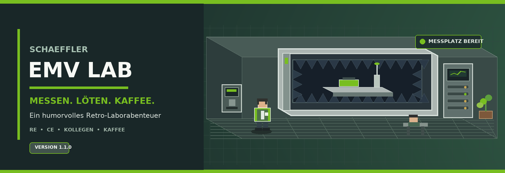
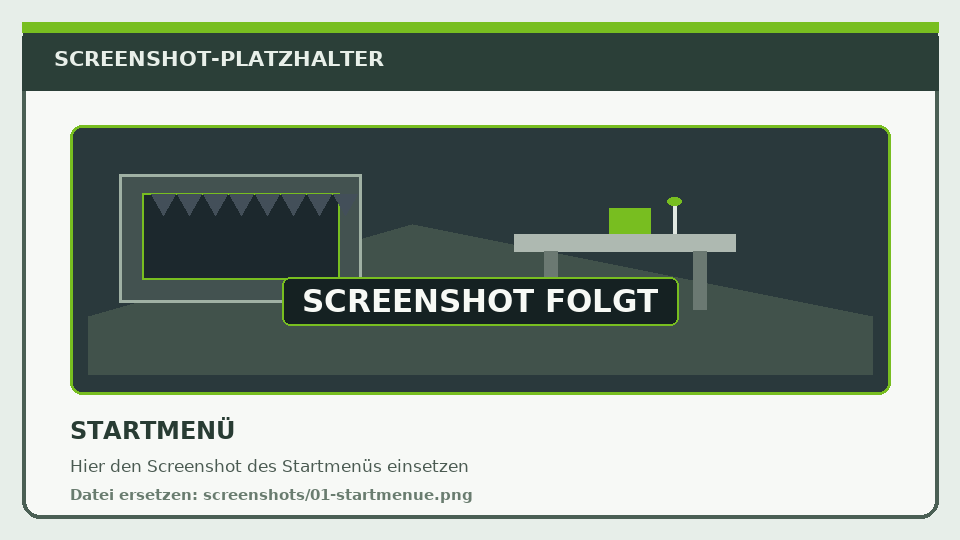
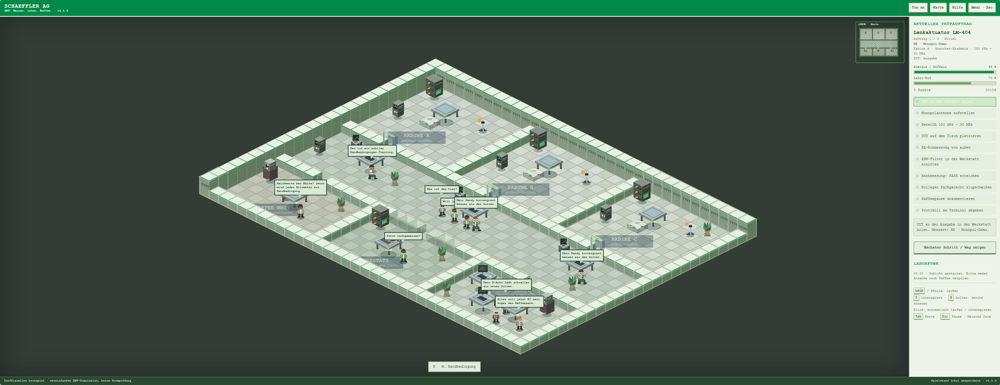

<!-- Direktstart-Badge und weitere Projekt-Badges -->
<p align="center">
  <a href="https://basecore.github.io/Schaeffler_EMV_Lab/">
    
  </a>
  
  
  
</p>

<p align="center">
  <a href="https://basecore.github.io/Schaeffler_EMV_Lab/">
    
  </a>
</p>

<h1 align="center">Schaeffler EMV Lab</h1>
<p align="center"><strong>Messen. Löten. Kaffee.</strong><br>
Ein humorvolles, browserbasiertes Retro-Laborsimulationsspiel.</p>

<p align="center">
  <a href="https://basecore.github.io/Schaeffler_EMV_Lab/">
    
  </a>
</p>

> **Kurz gesagt:** Messaufträge erledigen, Messaufbauten vorbereiten, Filter einlöten, Kaffee organisieren – und beim Chefbesuch möglichst beschäftigt aussehen.
>
> **Wichtiger Hinweis:** Das Spiel ist eine inoffizielle, fiktive Unterhaltungssimulation. Es enthält keine realen Laborpläne, Produktdaten oder normgerechten Messergebnisse und ist keine freigegebene EMV-Prüfsoftware.

## 🚀 Direkt spielen

**[▶ Schaeffler EMV Lab im Browser starten](https://basecore.github.io/Schaeffler_EMV_Lab/)** · [GitHub-Repository](https://github.com/basecore/Schaeffler_EMV_Lab)

Keine Installation und kein Build nötig. Am Smartphone wird die HTTPS-Version über GitHub Pages empfohlen. Lokal kann `index.html` in einem modernen Browser geöffnet werden.

## 🖼️ Screenshots

Die beiden Aufnahmen zeigen das **Startmenü** und eine **Ingame-Ansicht**. Das Menü ist bewusst kleiner dargestellt; der große Ingame-Screenshot zeigt die Laborumgebung im Detail.

<p align="center">
  <strong>Startmenü</strong><br>
  
</p>

<p align="center">
  <strong>Ingame – EMV-Labor</strong><br>
  
</p>

## 🎮 Spielinhalt

- **Retro-Labor in Grün, Grau und Weiß** mit 2.5D-inspirierter Spieloptik, Animationen und Sound.
- **RE-Messungen:** Kabinen A/B/C, Monopolantenne und einstellbarer Demobereich von 150 kHz bis 30 MHz.
- **CE-Messungen:** LISN beziehungsweise künstliches Netz vor dem DUT aufbauen, simulierte Verbindungen herstellen und die Messung von außen starten.
- **Messaufträge:** DUT holen und platzieren, Rohmessung durchführen, bei Bedarf einen EMV-Filter in der Werkstatt einlöten, nachmessen und das Protokoll abgeben.
- **Laboralltag:** Energie durch Kaffee auffüllen, Kaffeemaschinen warten, Blumen gießen und mit Kolleginnen und Kollegen sprechen.
- **Ereignisse:** zwei umherlaufende Simulationsingenieure, ein besserwisserischer Doktor und ein Chef-Alarm, bei dem zusätzliche Arbeit drohen kann.
- **Schwierigkeitsgrade:** Leicht (4), Mittel (6) oder Schwer (8) gemischte Aufgaben.
- **Mobil spielbar:** Touch-Steuerung, virtueller Joystick, Portrait-/Querformat und Zoom-Unterstützung.

## 🧭 Ablauf und Steuerung

### Typischer Messauftrag

1. Schwierigkeitsgrad wählen, Auftrag annehmen und das DUT an der Ausgabe holen.
2. Zugewiesene Messkabine betreten und den Messaufbau einrichten.
3. **RE:** Monopolantenne aufstellen und den Auftrag am Bedienfeld konfigurieren.
4. **CE:** LISN vor dem DUT-Tisch positionieren und die simulierten Verbindungen herstellen.
5. Kabine verlassen, Tür schließen und die Messung an der Außenkonsole starten.
6. Bei einer Rohmessung mit FAIL das DUT zur Werkstatt bringen, den Filter montieren und eine Nachmessung durchführen.
7. Weitere Auflagen erledigen und das Protokoll im Büro abgeben.

### Steuerung

| Aktion | Desktop | Smartphone / Tablet |
|---|---|---|
| Bewegen | `WASD` oder Pfeiltasten | Virtuellen Joystick ziehen |
| Interagieren | `E` | Aktionstaste antippen |
| Arbeit vortäuschen | `B` halten | Umschalter auf dem Bildschirm |
| Karte / Aufgaben | `Tab` / Aufgaben-Schaltfläche | Aufgaben-Schaltfläche antippen |
| Pause / Menü | `Esc` | Menü-Schaltfläche |
| Weg finden / Zoom | Klicken, Mausrad, `+` / `−` | Objekt antippen, Zwei-Finger-Zoom oder `+` / `−` |

Im Spiel führen Antippen oder Anklicken von Objekten beziehungsweise dem Boden zum automatischen Laufweg. Für Sound einmal **„Sound aktivieren & testen“** antippen; Browser geben Audio üblicherweise erst nach einer Nutzeraktion frei.

## ☕ Laborleben

Die Kolleginnen und Kollegen vor den Messkabinen sitzen am Schreibtisch und beschäftigen sich mit dem Handy – bis der Chef auftaucht. In den Kaffeeküchen geht es um Wetter, Elektroautos, Solaranlagen und KI; beim Chefbesuch wird plötzlich über Arbeit gesprochen oder ein spontanes Meeting angekündigt. Der Doktor verteilt ungefragte Ratschläge, etwa zum Erdungsring. Kaffeeautomaten brauchen Wasser, Bohnen, eine geleerte Kaffeeschale und gelegentliche Reinigung. Blumen können gegossen werden und trocknen im aktiven Spiel wieder aus.

Wird der Spieler beim Nichtstun erwischt, kann eine **zusätzliche** Wiederholungsmessung fällig werden. Sie ersetzt nicht die reguläre Nachmessung; offene Auflagen müssen vor der Protokollabgabe erledigt sein.

## 🛠️ Technik und Start

- Einstieg über `index.html`; eine eigenständige HTML-Spielversion liegt ebenfalls im Repository.
- `manifest.webmanifest`, `sw.js` und `icons/` unterstützen die optionale PWA-/Offline-Nutzung.
- Kein `npm`, keine externen Bibliotheken und kein Build-Schritt erforderlich.
- Der Offline-Cache wird nach dem ersten erfolgreichen Laden über HTTPS verfügbar.
- Spielstände werden lokal im Browser gespeichert. Einstellungen bieten JSON-Import/-Export; Mess-CSV und Schichtbericht können im Spiel exportiert werden.

<details>
<summary>GitHub Pages für einen eigenen Fork aktivieren</summary>

1. Repository forken oder die Projektdateien in ein eigenes Repository übernehmen.
2. Unter **Settings → Pages → Build and deployment** die Option **Deploy from a branch** wählen.
3. Branch `main` und Ordner `/(root)` auswählen und speichern.
4. Nach dem Deployment die angezeigte GitHub-Pages-Adresse öffnen.

Die Projektversion ist bereits über [GitHub Pages](https://basecore.github.io/Schaeffler_EMV_Lab/) erreichbar. GitHub Pages ist öffentlich: keine vertraulichen Labor-, Personen- oder Produktdaten veröffentlichen.
</details>

## ✅ Qualitätssicherung

Laut Testbericht bestehen **37 automatisierte Prüfungen**, darunter vollständige RE- und CE-Aufträge, Kampagnen, Wartung, Blumenpflege, Chef-/Doktor-Ereignisse sowie Touch- und Audio-API-Tests mit Testadaptern. Ein visueller Test in einem echten Browser und ein Hörtest auf realen Geräten wurden nicht durchgeführt. Details stehen im [JSON-Testbericht](EMV_Testbericht_v1.1.0.json).

## ⚠️ Fachlicher Hinweis

Die CE-Spielmechanik ist didaktisch an den Automotive-Kontext von CISPR 25 angelehnt; RE verwendet ein Monopol-Demoprofil. **Sämtliche Pegel, Grenzlinien und Filterwirkungen sind fiktiv.** Das Spiel ist keine vollständige Normprüfung, kein OEM-Freigabenachweis, keine reale Anschluss- oder Lötanleitung und kein Ersatz für geeignete Messgeräte, Fachpersonal oder gültige Normtexte.

## 📦 Version und Speicherung

Aktuelle Fassung: **v1.1.0** · [Änderungshistorie](CHANGELOG.md)

Version 1.1 nutzt eigene lokale Speicher-Schlüssel. Spielstände aus Version 1.0 bleiben erhalten, werden wegen der geänderten Aufgaben aber nicht übernommen. Der Exit-Button speichert und beendet die Laboransicht; Browser können das automatische Schließen eines manuell geöffneten Tabs blockieren.

## 👥 Credits, KI-Einsatz und verwendete Prompts

- **Konzept und Änderungswünsche:** Nutzeranfrage.
- **Umsetzung, Dialoge, originale Pixelgrafik und synthetischer Sound:** Schaeffler Chatbot / Data Science Solutions.
- **Verwendetes Modell (Projektangabe):** `GPT-6 Sol` am **17.11.2026**; angegebener Zeitaufwand: **ca. 20 Minuten**.
- Schaeffler AG ist thematischer Kontext. Dieses Projekt ist **inoffiziell** und kein freigegebenes Unternehmensspiel.

### Aktivierte Tools

Für die Erstellung wurden laut Projektangabe folgende Tools aktiviert:

- **Web Search** — A plugin that provides web search engine functionality. Take a text and search the web for search results and their content.
- **Data & Code Wizard** — Analyze files, build code, and generate outputs in one place.
- **Generate Image** — Generate images from text descriptions. You can customize the image quality (low, medium, high) and format (square, landscape, portrait).

### Prompt 1 – ursprüngliche Spielanforderung

```text
Erstelle ein vollständig funktionierendes Schaeffler AG EMV Labor Messsimulationsspiel in HTML.
Es soll eine retro grafik haben (vieleicht 2.5D RPG Style aus den 2000er).
Man soll verschiedene Aufgaben haben wie zum Beispiel in eine EMV Messkabine gehen,
dort eine Monopol Antenne aufstellen den Messbereich einstellen (150k bis 30MHz),
den DUT auf dem Tisch plazieren und dann wieder hausgehen und von außen die MEssung starten.
Es soll mehrer EMV Messkabinen geben. Es soll etwas ironisch und witzig sein.
Man soll regelmäßig in die KAffeeküchen gehen müssen um seine Energie aufzuladen.
Man muss weitere verschiedene Aufgaben erfüllen wie zum Beispiel
"einen EMV Filter einbauen/einlöten" damit die EMV Ergebnisse besser werden,
"Klugscheißen" bei den Kollegen.
Außerdem sollen immer zwei Simulationsengineure im EMV Labor herumlaufen
und fragen "was ist das hier" und "Meine Simulation konvergiert nicht"
und Kollegen fragen ob sie Kaffee trinken wollen.
Außerdem sind immer einige Kollegen in der Kaffeeküche.
Und wenn der Chef vorbeischaut, dann sollen alle so tun als würden sie arbeiten.
Bitte erstelle das vollständige Spiel mit Menü (mit leicht, mittel und schwer)
und Versionierung, Credits und Einstellungen und Exit-Button,
es soll außerdem Sound, Special-Effekts und guten Animationen haben und Bildern haben.
Das ganze Spiel soll witzig und etwas ironisch sein.
Und es soll vollständig spielbar sein.
```

### Prompt 2 – Überarbeitung und zusätzliche Funktionen

```text
Das sieht schon sehr gut aus. Es gibt ein paar Punkte die noch nicht passen.
Es soll mehr im Schaeffler Grün/Grau/Weiß gehalten sein.
Die Kollegen vor den Messkabinen sollen am Schreibtisch sitzen und am Handy spielen
und nur wenn der Chef kommt so tun als würden sie arbeiten.
der Sound funktioniert nicht, aktuell gibt es keine Hintergrundmelodie und keine Effektgeräusche.
Es soll Smartphone optimiert sein, also gut am Handy spielbar sein
und am besten direkt über Github dann spielbar sein.
Man soll auch die Blumen gießen können und man muss immer wieder mal
die Kaffeemaschine sauber machen (Wasser nachfüllen oder Kaffeeschale leeren
oder Bohnen nachfüllen).
Außerdem soll es noch andere Messungen geben wie Conducted Emission,
wo man die Lisn vor das DUT hinstellt und dann von außen CE misst
(nach Automotive Standard).
Und hin und wieder kommt der "Doktor" und labert blöd daher
also Klugscheißt noch viel mehr
(z.b. "Hast du es schonmal mit einem Erdungsring probiert")
(am besten sollte man ihn vermeiden).
Und wenn der Chef kommt dann muss man nochmal was nachmessen
wenn er einen Erwischt und man nicht so tut als würde man arbeiten.
Und in der Kaffeeküche wird über das Wetter, Elektroautos,
die eigene tolle Solaranlage verglichen, über KI geschimpft und gehunldigt
und wenn der Chef reinkommt, dann wird plötzlich über die Arbeit geredet
oder die Kollegen gehen an ihren Arbeitsplatz und sagen "Oh ich habe ein Meeting".
```

---

<p align="center"><sub>© Schaeffler EMV Lab · Fiktive Spielsimulation · Nicht offizielle Unternehmenssoftware</sub></p>
